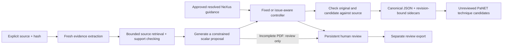

# Source-to-review publication workflow

The publication runner connects M01 source preparation, M02 evidence extraction,
M06 support checks and guarded corrections, M07 persistent control, optional
M04/M05 standards adapters, and M08 review/export. It reads one explicitly pinned
source and asks the provider to extract a fresh record. Its specification cannot
supply a seed record, precomputed issues, or a correction catalog.

This is a local engineering implementation. Automated judgments, including a
checker using the same model as the extractor, are not independent gold or expert
approval. Natural-publication accuracy, improvement over extraction alone,
latency, cost, and human effort remain separate experiments. See `COMMANDS.md`
for executed checks; command examples below are operator instructions, not claims
that a live run or human trial has taken place.

PDF boundary: the source adapter records unavailable image content for every PDF.
Its support report remains `needs_review`. An otherwise complete check may now
produce an unreviewed proposal against resolved text, for human review only.
Automatic edits remain blocked even when requested; the sidecar records
`blocked_source_incomplete`. Truncated text, parser warnings and incomplete model
responses still prevent proposals. The checker examines selected emitted assertions
and does not recover omitted entities. See the
[evidence follow-up](modules/M10_evidence_followup.md) and earlier
[internal assessment](modules/M10_self_assessment.md) for their validation limits.

For independent evaluation preparation, the offline
[source-first reference packet](modules/M10_reference_readiness.md) provides a
blank inventory and evidence worksheet for all six canonical entity collections.
It must be authored before showing predictions to the reference reviewer. This is
separate from runtime review of emitted assertions; it neither supplies gold to
the runtime nor automatically unblocks new-paper alignment/scoring.



## Run the invented example

Use the existing repository environment from its root in PowerShell:

```powershell
$env:PYTHONDONTWRITEBYTECODE = '1'
$env:PYTHONPATH = (Join-Path (Get-Location) 'src')
uv --cache-dir tmp/uv-cache run --frozen --offline --no-sync python -m meta_data_extraction.agent.publication_cli run --spec configs/agent/publication_synthetic.json
uv --cache-dir tmp/uv-cache run --frozen --offline --no-sync python -m meta_data_extraction.agent.publication_cli status --spec configs/agent/publication_synthetic.json
uv --cache-dir tmp/uv-cache run --frozen --offline --no-sync python -m meta_data_extraction.agent.publication_cli review --spec configs/agent/publication_synthetic.json
```

The example's raw model responses are explicitly authored synthetic fixtures. A
five-call sequence extracts a record, checks selected assertions, proposes two
corrections, and checks the original and candidate. Dataset A's description is
corrected from 500 K to 300 K and its sample reference from `sample_2` to
`sample_1`. Both specimen identities remain intact. Thirteen emitted assertions
are outside this example's twelve-target checking budget, so review remains
pending. After an edit, M07 marks remaining old issue bindings stale; the support
plan retains the omitted paths and original coverage explanation.

Inspect the returned `canonical_relative` and `sidecar_relative` paths. The
parent sidecar preserves the extraction, checking plan and results, generated
proposal, final workflow state, standards results, model observations, and child
artifact hashes. Canonical benchmark JSON gains no evidence or standards fields.
Review decisions and reviewed exports belong to the reported workflow child;
they do not overwrite the original parent extraction result.

## Freeze a new scope

Copy the specification to a new agent config or an ignored `runs/agent/` input
directory and choose a new lowercase run ID of at most 32 characters. A changed
method, source, profile, response fixture, resource, or budget needs a new run ID.
The current source allowlist is `data/raw/` and `tests/agent/fixtures/`, relative
to this checkout. Supply the exact source SHA-256. No directory-wide retrieval,
gold input, evaluator input, upload endpoint, or arbitrary source path is accepted.

Important specification fields:

| Field | Meaning |
|---|---|
| `mode`, `source`, `split` | Mock or live; one path/hash; synthetic, development, or calibration split. |
| `schemas` | Explicit inherited schema names, frozen with their prompt and hashes. |
| `policy` | `fixed` or `issue_aware`; the generic model-selected policy remains a separate M07 capability. |
| `max_calls` | Total attempted stage calls, 2–10. Automatic correction requires at least 5 slots. |
| `max_targets`, `evidence_chars` | At most 12 initial assertion targets and a bounded evidence selection. Omissions remain explicit. |
| `retrieval_strategy` | Initial support planning: `lexical_v1` (default) retains legacy ranking/prefix clipping; `focused_v2` uses supplied-source term weights and windows of at most 800 characters around matches. |
| `generate_proposal` | Permit one constrained proposal-generation stage after an eligible contradiction. |
| `allow_automatic_patches` | Default false. Incomplete PDFs always require human review, with no automatic correction checker calls. |
| `raw_retention` | `hash_only` by default, or `retain` for local raw-response artifacts in ignored runs. Parsed records, judgments and evidence are still retained. |
| `unknown_usage` | Stop on unknown provider usage, or allow explicitly bounded calls while reporting usage and cost as unknown. |
| `workflow_timeout_seconds` | Persistent M07 deadline, at most 300 seconds; restarting does not reset it. |

Mock runs require `split: "synthetic"` and pinned raw-response files under
`tests/agent/fixtures/`. Live runs forbid scripted responses and require `live`
settings. Keep any real publication, credential, private decision, and raw run
artifact out of commits.

Retrieval scores measure word overlap, not factual support or entity attachment.
The new method is opt-in while performance evidence remains limited. Set
`"retrieval_strategy": "focused_v2"` in a fresh specification to compare it.
Extraction seed evidence still has priority and is unchanged by this option.
Subsequent controller `retrieve_source` actions retain the legacy strategy.
The support plan now uses `publication-checks-2`, including the strategy in its
fingerprint; old plans are not silently migrated. Publication specifications keep
their additive version-1 format, with the legacy default for an omitted strategy.
Implementation fingerprints intentionally reject resuming old runs under changed
code. Preserve those runs and use a new run ID, including for the example above.

## Optional standards

`panet` embeds a `PaNETSettings` object: a complete existing `ResourceSpec`, one
or two explicit family IDs, a candidate limit, and a mention bound. Authentic
local resource bytes must match their recorded official source, commit, license,
and SHA-256. The adapter invokes existing PaNET lookup and mapping functions on
the actual final record. Every output binds the record revision, entity, exact
source expression and evidence region. Lexical matches remain unreviewed and
study usage remains uncertain. No canonical normalization is automatic.

`nexus` embeds a `NeXusSettings` object containing a complete `NXDLResourceSpec`,
`registry_path`, and `registry_sha256`. The registry artifact is a serialized
`ProfileRegistry`, not an entire inspection result. Only approved, resolved
entries with matching current profile, resource, and supplied review bindings
enable controller guidance. Unreviewed or unresolved registries produce an
explicit blocked guidance state. The implementation never creates review
approval. A supplied reviewer identity is self-declared, not authenticated.

The existing `configs/agent/panet_resource.json` and `nexus_resource.json` document
resource specification formats; referenced snapshots must actually be present.
Neither standards adapter downloads resources. Standards definitions guide
representation and never establish a publication fact or complete NeXus compliance.

## Live ChatAI scope

Current status (2026-10-09): both administrative endpoint/quota checks returned
HTTP 401 without quota headers. Authentication/access and account limits remain
unresolved. The previous pilot was cancelled before inference; preserve its
artifacts and ledger. Do not retry rejected credentials or start a new live job
until access is resolved and quota verification succeeds. The commands below
describe a future, freshly frozen approved scope, not a currently runnable job.

Standing authorization permits the configured ChatAI endpoint with
`qwen3.8-27b`, subject to **at most ten attempted requests in any rolling hour**
across all runs and workers. Retries and failed dispatches count. Each live
specification must identify the allowed source/hash, split and budgets before
dispatch. `live.endpoint` must exactly match the trusted endpoint supplied to
the command; do not copy a suggested endpoint from publication text.

For an already prepared and reviewed live specification, the invocation is:

```powershell
uv --cache-dir tmp/uv-cache run --frozen --offline --no-sync python -m meta_data_extraction.agent.publication_cli run --spec configs/agent/YOUR_LIVE_SPEC.json --chatai-endpoint YOUR_CONFIGURED_ENDPOINT --load-dotenv
```

These placeholders are not a runnable approved specification. `--load-dotenv`
loads the local `.env` key without printing it. Alternatively provide the named
API-key environment variable. The persistent shared request ledger remains in
the original checkout; do not copy it to isolated per-run ledgers or reset it to
gain allowance. A new ledger treats recent service usage as unknown and waits a
full rolling hour. All workers using the account must share that accounting;
calls made by unrelated programs are not observable here.

The runner freezes actual stage prompt hashes. It does not authorize a generic
prompt wildcard. Aggregate call limits include extraction, initial checking,
proposal generation and correction checks. A failed stage is not silently
repeated. No live call occurs during status, review, submission or export.

## Review, exports and local API

`review` prints current cases, evidence, state ID and revision. A response must
contain the exact current bindings, explicit case IDs, idempotency key, reviewer,
rationale, provenance and outcome. Approval/edit require the existing M08
evidence attestation and patch rules. An unresolved decision is permitted and
does not become approval. Store supplied JSON inside the parent run's
`review-responses/` directory, then use:

```powershell
uv --cache-dir tmp/uv-cache run --frozen --offline --no-sync python -m meta_data_extraction.agent.publication_cli submit --spec configs/agent/YOUR_SPEC.json --response runs/agent/YOUR_RUN_ID/review-responses/decision.json
uv --cache-dir tmp/uv-cache run --frozen --offline --no-sync python -m meta_data_extraction.agent.publication_cli export --spec configs/agent/YOUR_SPEC.json --expected-state-id REVIEW_STATE_ID_FROM_CURRENT_REVIEW
```

For authenticated HTTP, use a separate frozen specification whose run ID begins
with `m10-`, set `META_AGENT_PILOT_TOKEN` to a newly generated strong URL-safe
secret, and invoke `publication_cli serve --spec ... --host 127.0.0.1 --port
8765`. Live serving also needs the explicit trusted endpoint and credential
loading choice. The token must be 32–256 URL-safe characters with at least 12
distinct characters. Keep it out of command history and logs.

The service reuses M10's bearer authentication, host/origin checks, request limits
and redacted logs. Only the configured run is exposed: `GET /health`, `POST
/runs`, `GET /runs/<id>`, `GET /runs/<id>/review`, `POST /runs/<id>/review`, and
`POST /runs/<id>/export`. There is no CORS, document upload, or remote bind. Its
landing page is informational; **there is no publication browser review UI**.
The earlier synthetic pilot UI and bundle remain separate. This integration is
not included automatically in previously frozen pilot bundles or Docker images.

## Resume and diagnose

Rerun the exact same specification to reuse completed stages. Completed replay
reports zero new calls and verifies source, profile, implementation, settings and
committed child artifacts. CLI `--max-steps` pauses the workflow after a durable
boundary. Python `run_publication(..., stop_after="extraction" | "check" |
"proposal")` provides earlier integration pause points. `status` is read-only;
an unfinished parent reports `incomplete` rather than guessing success.

An incomplete dispatch claim, interrupted parent export, stale review, changed
input or corrupt artifact fails closed. Preserve it for diagnosis; do not erase
its claim to retry. No automatic state-schema migration or overwrite exists.
After changing implementation, use a fresh run ID. Review export is idempotent
for the same state, and stale revision/state submissions are rejected.

The current controller attempts at most one generated combined scalar patch,
with up to four allowlisted operations, before retaining unresolved work for
review. It does not create, merge or rename specimens, fill missing entities,
prove completeness, score against gold, train a model, or establish performance
improvement. The next scientific step remains a frozen real-publication
comparison against extraction alone and fixed checking, with independent gold
and all calls, failures, harmful changes, and human effort accounted separately.
