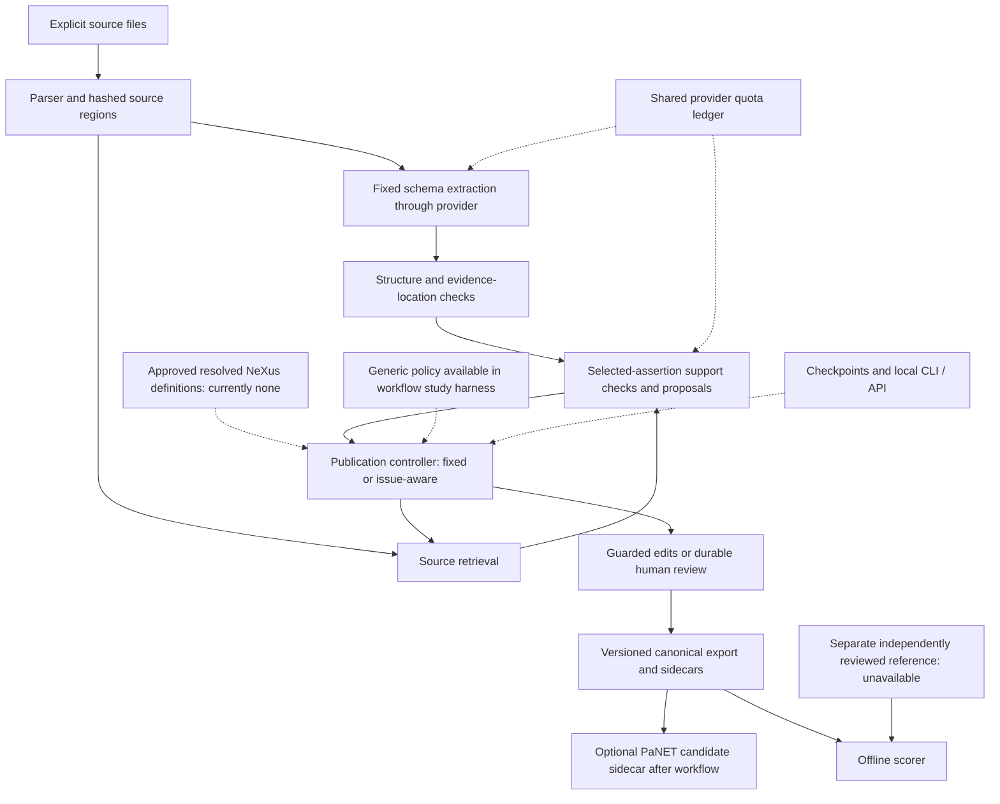

# M10 comprehensive component evaluation — 2026-10-09

Question: what measurable gain, loss, cost and remaining uncertainty does each
implemented component introduce relative to its applicable baseline?

Scope: the user's requested evaluation of the current system, within M10. Freeze
code and cases before new diagnostics; do not tune implementation to the results.
No new inference/authentication attempts: the user confirmed service access remains
unresolved. Reuse saved natural retrieval artifacts and the existing synthetic
fixtures/functions/scorer. Do not inspect natural gold, change the evaluator,
regenerate released results, add independent labels or simulate human evidence.

Starting architecture: one source-to-extraction/checking/proposal workflow; fixed
and issue-aware publication policies, plus generic control in the study harness;
source and standards tools; guarded
scalar edits; durable review; local CLI/API and fixture browser; separate offline
scoring/reference tools. This is not a set of independently trained agents.

Baselines and outcomes are component-specific. Compare retrieval with prefix and
legacy lexical selection; schema/evidence checks with parsing alone; guarded edits
with no edit and unchecked candidates; controller policies with equal tool/model
access and call caps; persisted replay with recomputation; standards lookup with
exact-label/no-guidance behavior. Report raw counts, harms and abstentions. Do not
sum these different outcomes into a schema-wide gain or treat test passes as
extraction accuracy. Scripted model calls measure execution paths only.

The fresh run is `runs/agent/m10-component-eval-v1/`. Each component subdirectory
must freeze its exact case manifest and helper/code/resource hashes before its
first execution. Natural retrieval uses the previously inspected calibration
paper and unchanged internal labels, explicitly development replay. Synthetic
challenge cases are authored before execution and reported separately.

Required checks: source/hash resolution, all planned cases retained, equal-scope
comparisons, observable changes/calls/errors, explicit unknown costs/latencies and
human effort, preserved frozen artifacts, and no runtime/schema/evaluator changes.
Counterexamples and negative results remain in the report. Natural model-dependent
component gains remain unmeasured where external access or independent truth is
missing; engineering diagnostics must not substitute for those measurements.

Status at start: offline diagnostics `not_run`; live extraction and independent
human outcomes `blocked`. The last full safe runtime baseline is 2,569 passes;
the latest offline/reused-boundary regression is 591 passes, including 85 new
reference-readiness tests. Evaluation here adds no product features or M11 work.

## Findings

The system has demonstrated useful retrieval, validation and recovery behavior,
but **no verified overall natural-paper extraction gain**. The comprehensive
offline evaluation finds both benefits and concrete losses. Counts below describe
their stated fixtures or resource strings, not deployed error rates. No component
received an independent natural-paper accuracy estimate in this run.

Artifacts: `runs/agent/m10-component-eval-v1/`, with separate frozen protocols in
`retrieval/`, `checks-evaluation/`, `standards-evaluation/` and
`orchestration-evaluation/`. Each helper and its inputs were pinned before its
diagnostic execution. Reports retain all negative cases. No runtime, schema,
resource, evaluator, dependency or configuration was changed to improve scores.

## Actual architecture and evaluation boundaries

The inherited `meta_data_extraction` package, PDF parser, provider adapter and
canonical schemas remain. New functions implement the bounded service under
`agent/`; a thin LangGraph adapter adds durable execution. The system does not
contain independently trained extractor, verifier and standards agents.

PaNET is postprocessing in the publication runner, not a controller lookup tool.
NeXus is a potential controller input, but its real registry contains no approved,
resolved guidance. Temperature arithmetic is an optional separate helper. The
browser pilot uses fixtures; the fresh-publication interface is CLI/JSON API.
Human review is implemented but the user deferred its usability trial.
The publication policy defaults to issue-aware. Automatic patches default off;
accepting model judgments is an additional explicit policy choice. Generic control
is available in the lower-level workflow/study harness, not `PublicationSpec`.

## Component results

| Component and role | Observed gain | Observed loss or limit |
|---|---|---|
| Run isolation, immutable manifests, runtime/offline separation | Fresh directories, source/profile hashes and allowlisted reads keep experiments separate; regression tests exercise protected paths and replay | Storage and hashing cost; no extraction-accuracy effect established |
| Source parsing and region construction | Existing calibration snapshot has 22,929 characters in 78 resolvable regions from an 11-page PDF | Parser text only: images and page mapping unavailable; OCR, tables and full-source recall are unmeasured |
| Fixed extraction/provider boundary | Malformed JSON and duplicate keys fail explicitly in 2/2 designed cases; failure is not a successful empty record | Model extraction quality unavailable; evidence prompt adds 689 UTF-8 bytes, about 2.0%, on the fixture, not a token/cost measurement |
| Frozen profile and local-reference validation | Rejects both designed type/dangling-reference defects | A valid local ID can still name the wrong sample; omission of an unreferenced entity stays structurally valid |
| Exact evidence binding | Both forged/missing-link cases become `needs_review`; retained links resolve to actual hashed text | All three designed semantic/coverage defects (wrong value, wrong attachment, omitted sample) still pass the extraction contract, with support `not_assessed` |
| Source retrieval | Focused windows improve natural development evidence capture at both budgets; details below | About 14 times legacy local search time; four authored context/chemical-symbol losses; production-generated queries were not evaluated |
| PaNET candidate lookup | Known-resource label/alias targets at rank one: 29/50 exact-label baseline versus 50/50 lexical lookup, 21 gains and no target losses | Every query adds overlapping candidates; narrow two-family scope and resource self-retrieval do not measure publication mapping accuracy |
| PaNET mapping and mention gates | 18/18 prescribed gate outcomes, retaining four eligible unreviewed proposals and withholding 13 unverified proposals | Literal integration locates only 1/3 wording variants; case/acronym variants missed. Canonical unchanged in all three probes; no direct extraction gain by construction |
| NeXus definitions/registry | Three definitions and four proposed field-role contexts are retrievable | Six mapping requests give four unresolved and two no-match states; zero approved guidance currently enters extraction |
| Quantity normalization | Four convertible requests produce exact expected arithmetic; all 14 preserve supplied raw-expression state | Two unavailable and eight rejected; ranges, scientific notation and uncertainty are unsupported. Inconsistent supplied value/raw text can convert without evidence validation |
| Source-support checker | Honest scripted responses expose both designed semantic contradictions; invalid evidence blocks dispatch and timeout/unknown finish are explicit | A scripted false `supported` verdict passes contract checks. Checking emitted assertions does not detect an omitted entity; diagnosis accuracy remains unknown |
| Proposal/patch boundaries | Two legitimate corrections apply under explicit model-judgment acceptance; stale revision and entity-creation attempts are rejected | One damaging edit also applies when both checker judgments are consistently wrong. Default policy makes no automatic changes; partial PDFs stay human-review only |
| Fixed versus issue-aware controller | Equal two-correction/two-call result on the standard repair fixture; issue-aware saves one retrieval action on a conflict-labeled issue | Wrong conflict diagnosis defers both otherwise correctable errors; no demonstrated general adaptive accuracy benefit |
| Generic model-selected controller | Same two corrections when given five calls | Uses five versus two calls (+150%); at cap two, neither correction occurs. Authored selectors, not observed Qwen decisions |
| LangGraph/persistent execution | Direct and persistent final states/actions match in three pairs; completed replay uses zero new calls; child-process resume preserves work | Full persistence adapter median 317 ms versus 112 ms direct; median paired addition 221 ms. This includes hashing/I/O/export, not pure LangGraph overhead |
| Human review/revisions/export | Tests verify stale-edit rejection, pending-not-approved semantics and idempotent exports | No measured expert correctness, human effort or browser usability; conservative routing increases pending work |
| Provider request accounting | Offline fake SDK/clock tests exercise shared budgets, failed attempts and cross-run limits | Ten/hour remains unchanged; unresolved reservations conservatively retain quota. Real throughput, usage, latency and price are unknown |
| CLI, authenticated local APIs, browser/package | Offline and loopback checks exercise operations, authentication, recovery and export | No extraction-quality benefit attributable to packaging; rendered-browser, Docker and human trial remain unrun |
| Offline evaluator/reference preparation | Existing omission checks count missed gold entities; two gold entities/one correct prediction yield F1 2/3 | No independent natural reference or reviewed new-paper correspondence is available; the blank packet is incomplete, not zero entities or gold |

## Retrieval: positive development replay and negative stress cases

Unchanged calibration paper `1812.03956`; ten handwritten questions, eight with
answerable internal reference phrases and 14 required evidence components. This
paper and these assistant-derived labels were already inspected. A complete
question requires every expected phrase inside a returned passage; the two
unanswerable questions are not silently treated as failures or successes. All 40
legacy/focused selections reproduced earlier artifacts exactly. Prefix results
were also recomputed. These are evidence-capture counts, not extraction scores.

| Character cap | Selection | Complete questions | Required components found | Mean characters, all 10 queries | Median local search, 50 timings |
|---:|---|---:|---:|---:|---:|
| 1,500 | Prefix | 0/8 | 0/14 | 1,500 | 0.11 ms |
| 1,500 | Legacy lexical | 2/8 | 4/14 | 1,500 | 1.15 ms |
| 1,500 | Focused | 4/8 | 7/14 | 1,449.4 | 15.76 ms |
| 6,000 | Prefix | 1/8 | 3/14 | 6,000 | 0.20 ms |
| 6,000 | Legacy lexical | 3/8 | 6/14 | 3,020 | 1.17 ms |
| 6,000 | Focused | 4/8 | 7/14 | 1,750.6 | 15.96 ms |

Versus legacy, focused gains 25 percentage points in complete questions at 1,500
characters and 12.5 points at 6,000; no losses on this small development replay.
Mean returned text falls 3.4% and 42.0%, respectively, but shorter text is not a
measured token/cost saving. Five alternating timing repeats per query are descriptive
measurements during concurrent local work, not an isolated latency benchmark.

The ten predeclared invented stress cases give one improvement, four losses and
five ties against legacy. They deliberately test boundaries, not their prevalence:

| Case | Legacy required phrases | Focused required phrases | Interpretation |
|---|---:|---:|---|
| Fact late in a long paragraph | 0/1 | 1/1 | Focused window reaches beyond prefix |
| Two distant facts in one region | 2/2 | 1/2 | One 800-character window loses the second fact despite a 6,000 budget |
| Chemical symbol `In film` | 1/1 | 0/1 | Casefolded `in` is a generic stopword; focused selects earlier Ga film |
| Distant negation context | 2/2 | 1/2 | The value survives while the statement excluding it is clipped |
| Distant sample attachment context | 2/2 | 1/2 | Temperature survives while its sample association is clipped |
| Rare term versus two common terms | 0/1 | 0/1 | Term weighting does not solve every relevance ranking |
| Budget shorter than a token | 0/1 | 0/1 | Neither supplies full fact |
| No matching word | Correct abstention | Correct abstention | Explicit no-match |
| Caption attachment | 1/1 | 1/1 | Both retain required sample-value relation |
| Query made only of stopwords | 1/1 | 1/1 | Focused fallback retains query |

Worked example: `In film` should select the paragraph saying the In film was
measured at 80 K. Legacy does. Focused removes `in`, ties on `film`, and returns
the earlier Ga film at 90 K. Its link is valid, but the retrieval is wrong for the
query. Similarly, a valid 80 K quotation can omit the distant statement that the
value was historical and not used. This is why citation validity and scalar
occurrence cannot stand in for attachment or semantic support. Keep focused
retrieval opt-in; its current default remains legacy and no method was tuned here.

## Corrections, controller ablations and recovery

The checking panel has ten extraction, eight support and nine patch cases,
requiring 31 scripted calls. Ordinary JSON parsing accepts 9/10; profile checking
accepts 7/10; the full evidence contract has four successes, two review states and
four failures. Those are gate-behavior counts, not precision/recall.

Each patch case has its own invented starting record. The selected description
and attachment are scored separately; they are not a schema-wide average.

| Patch strategy, nine cases | Correct descriptions | Correct sample references | Improved cases | Harmed cases |
|---|---:|---:|---:|---:|
| Leave unchanged | 4/9 | 8/9 | 0 | 0 |
| Apply prepared candidate without support gate | 5/9 | 9/9 | 4 | 2 |
| Default policy | 4/9 | 8/9 | 0 | 0 |
| Explicit acceptance of model judgments | 4/9 | 9/9 | 2 | 1 |

The gate prevents one damaging unchecked edit and defers two numerically correct
edits whose checks carry an injected conflict or incomplete-PDF condition. The
remaining harm is a deliberately false pair of support judgments: the source says
300 K, the before-check incorrectly says 300 K is contradicted, and the after-check
incorrectly says proposed 900 K is supported. With explicit acceptance enabled,
the existing executor applies 900 K. Default policy rejects it. This establishes
a possible failure, not its probability; all three applied receipts replay
idempotently, including the harmful one. No proposal-generating model was tested.

The separate orchestration panel starts from supplied errors, proposal and checker
responses; extraction and proposal generation are excluded equally from each arm.
These correction arms explicitly enable acceptance of model judgments; they do
not represent the default automatic-patch policy.

| Policy | Call cap | Corrected description | Corrected attachment | Scripted calls |
|---|---:|---:|---:|---:|
| Fixed | 2 | 1/1 | 1/1 | 2 |
| Issue-aware | 2 | 1/1 | 1/1 | 2 |
| Generic model-selected | 2 | 0/1 | 0/1 | 2 |
| Fixed | 5 | 1/1 | 1/1 | 2 |
| Issue-aware | 5 | 1/1 | 1/1 | 2 |
| Generic model-selected | 5 | 1/1 | 1/1 | 5 |

Generic spends three selector calls in addition to two checker calls. The former
M09 reference F1 values describe a different denominator (existing plus repaired
references); the current table counts the two specific interventions and does not
replace the frozen scorer. On a conflict-labeled issue without a proposal,
issue-aware takes one action
versus fixed's two, both with zero calls and one pending review. With an injected
wrong conflict diagnosis on the correctable record, fixed repairs both errors in
two calls; issue-aware repairs neither, uses no calls and leaves two pending cases.

Manual mode leaves both supplied errors unchanged and both reviews pending;
automatic mode with correct scripted checks repairs both in two calls. This is
not expert review and does not measure the quality of generated proposals.
Invalid selector actions, selector/checker timeouts, repeated retrieval and
insufficient checker budget stop explicitly without an unintended correction.
The repeated-retrieval case stops after three selector calls; the one-call budget
does not dispatch a two-check correction.

The persistent/direct comparison matches all observable state except elapsed time
in three pairs. Completed replay makes no calls and preserves seven files. Pauses
after one and two transitions resume in fresh child processes with call splits
0+2 and 2+0: total two in each case, with no duplicated committed work. The measured
local overhead buys replay/recovery; it does not improve extraction truth. A crash
with uncertain dispatch still requires conservative manual resolution.

## Interpretation and next dependency

Use the fixed controller as the current comparison baseline (the publication
default remains issue-aware): issue-aware control
has not demonstrated an extraction advantage, and generic selection costs more
in the tested paths. Retain evidence links, strict structure checks, guarded
updates, persistence and explicit review for their demonstrated engineering roles.
Their presence does not certify scientific correctness. Do not promote focused
retrieval or automatic patches on these small favorable cases alone.

The highest-value next work remains **M10 empirical validation**, not M11:
independent source-first entity/attribute/reference annotation and reviewed
correspondences, followed by a frozen paired comparison once ChatAI access and
quota verification are corrected. Keep extraction-only, checked/proposed,
automatically corrected and human-reviewed stages separate. Evaluate diagnosis
accuracy, omitted entities and harmful edits explicitly. Standards need genuine
mapping review before an active-guidance ablation is possible. A returned API key
alone is insufficient; the existing endpoint/authentication block remains.

Natural model accuracy, real proposal/diagnosis quality, downstream retrieval
effect, independent standards mapping, token/cost/latency, human effort/usability,
full-PDF coverage and Docker execution remain unmeasured. No natural gold was
opened for scoring and no approval or expert label was invented.

## Commands, verification and handoff

The frozen helpers ran once after preparation, with `uv --cache-dir tmp/uv-cache
run --frozen --offline --no-sync python` and source-path setup. Exact commands and
the two pytest file lists are in `../COMMANDS.md`; each component also retains its
execution/audit commands. The retrieval helper had a syntax error before its
protocol was created; the standards helper initially lacked invented workspace
markers. Both were corrected before any diagnostic output existed. No fixture,
method or outcome rule was changed after results.

Fresh regression: **1,400 passed in 299.52 seconds**, followed by **147 distinct
provider/service/resource-boundary checks passed in 15.82 seconds**: **1,547 passed**
in total. These are engineering checks, not performance observations. External
network is blocked; HTTP checks use temporary loopback servers and synthetic data.
The file named `test_publication_live.py` uses a fake SDK/clock and makes no live
calls. No whole-suite rerun was needed because product code stayed unchanged.
No lint/type tooling is configured. Browser rendering, Docker, human trials,
external inference and released-result regeneration were not run.

Across new experiments there were **70 explicitly scripted provider invocations**
(31 checking, 39 orchestration), with zero live model requests or credential/auth
attempts. Standards/retrieval made no model calls. Unit-test mock invocations are
separate from these experiment totals. Real model token usage, cost and latency
remain unknown; there was no new live-model charge. The shared ten/hour ledger
and cancelled job remain preserved.

Independent agent cross-audits verified retrieval counts, saved passages and
checking/patch denominators; they are software audits, not independent scientific
gold. Retrieval audit verified 11 frozen pins, 40 old selections and 424 evidence
instances. Checks audit verifies 81 implementation pins and three idempotent patch
replays. Standards verifies 67 inputs; orchestration verifies 74 pins, 22 rows,
26 states, 39 attempts, three parity pairs and two child-process resumes.

`final-audit.json` in the run records the final workspace/protected-data/prior-run
hash comparison, result recomputation, helper syntax and secret-pattern checks.
The starting inventory contains 1,770 files and hashes 16,978 existing run artifacts;
all 1,478 protected benchmark/result files are included. Evaluation documentation
and ignored diagnostic artifacts are the only intended changes. Code, schemas,
benchmarks and raw results were not regenerated.

Status: **`pilot` for offline development/synthetic diagnostics; `blocked` for
natural model-performance validation; human review/usability `not_run`**. This
completes the requested component assessment within M10. Recommended next module
remains M10 validation and handover, after the named independent-reference and
service-access dependencies; M11 is not opened.
